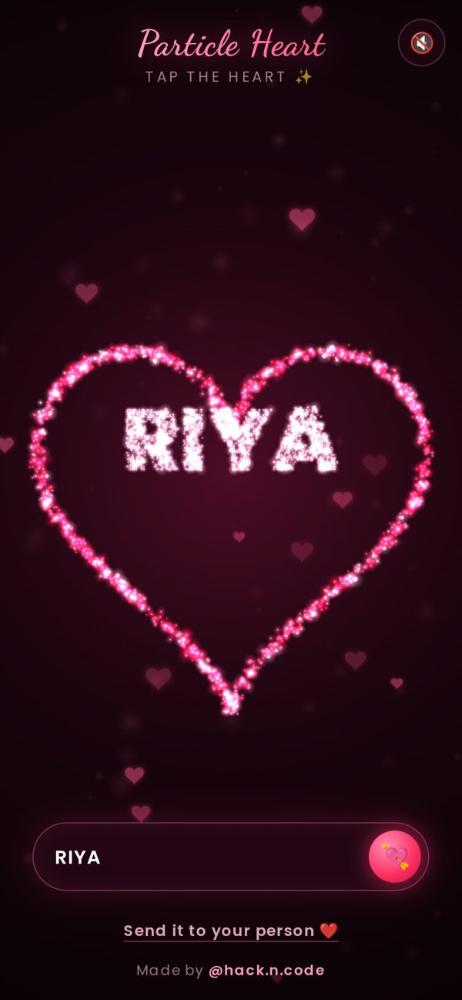

# 💘 Particle Heart — type your person's name

A beating **3D heart made of 3,600 glowing particles**, built with pure **HTML, CSS & JavaScript** (no libraries).

🔴 **Live demo:** https://love-heart-hackncode.sites.tab.bot/
💌 **Try with a name:** https://love-heart-hackncode.sites.tab.bot/?name=DHRUVI

<p align="center"></p>

## ✨ Features
- 3D heart sampled from the heart surface equation `(x² + 9/4·y² + z² − 1)³ − x²z³ − 9/80·y²z³ = 0`, gently turning
- Real lub-dub heartbeat (100 bpm), soft glow and floating mini hearts
- **Tap** → the heart explodes and the particles re-form into **"I LOVE YOU"** 💥
- **Type a name** → it forms inside a glowing heart outline ❤️
- **Send it to your person**: the share button creates a link with the name in it (`?name=...`)
- Drag to turn the heart, optional heartbeat sound (off by default)
- Mobile-first: fewer particles on phones so it stays smooth

## 🚀 Run it
Just open `index.html` in a browser, or serve the folder:
```bash
npx serve .
```

## 🧠 How it works
- `heart.js` samples points on the 3D heart surface (ray marching + bisection), projects them with perspective and a slow rotation.
- Text ("I LOVE YOU" or a name) is drawn on a hidden canvas and its pixels become particle targets.
- Every particle is a spring: explosion gives it a velocity, then it springs to its new target.
- Glow = additive blending of soft sprite dots.

Made with ❤️ by **[@hack.n.code](https://instagram.com/hack.n.code)** · Comment **LOVE** on the reel for more!

MIT License
